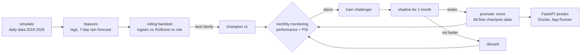

# closure-risk-mlops

[](https://github.com/locquangnguyen8/closure-risk-mlops/actions/workflows/ci.yml)

Forecasts the risk that a shellfish harvest area will be **closed within the next 7 days**, with the parts a model needs to stay useful after it ships:

- **A leak-free backtest** over 12 monthly folds, with a 7-day embargo between training and test data.
- **Model selection by evidence.** Logistic regression, XGBoost and a rule-of-thumb baseline compete. The best one goes to production, and here that's logistic regression.
- **Drift monitoring.** Each month: live performance, plus population stability index (PSI) on key inputs over a 90-day window.
- **Gated retraining.** A drift or performance alarm trains a challenger, which runs in shadow for a month and replaces the champion only if it scores better on data neither model has seen.
- **MLflow** experiment tracking and model registry. The `champion` alias always points at the production model, and replaced models are tagged `retired`.
- **A FastAPI service** that returns each prediction with its top drivers, plus a Docker image and **Terraform for AWS** (ECR, App Runner, S3).

The data is **synthetic** and simulated with known physics. Rain raises river flow, flow lowers salinity, and the program's closure rules turn those into closures. From July 2025 the simulation adds **deliberate drift** (wetter weather and a catchment that responds more strongly to rain), so the monitoring loop has something real to detect. The scenario matches the fictional monitoring program in [grounded-rag-eval](https://github.com/locquangnguyen8/grounded-rag-eval).

## Pipeline



## Results

### Backtest (2024-07 to 2025-06, before the drift)

| Model | Balanced accuracy | ROC AUC | Recall | Precision | Brier |
|---|---|---|---|---|---|
| **Logistic regression (selected)** | **0.826** | 0.902 | 0.813 | 0.529 | 0.123 |
| XGBoost | 0.795 | 0.904 | 0.723 | 0.548 | 0.108 |
| Rule: forecast day > 30 mm or salinity < 24 PSU | 0.590 | 0.590 | 0.729 | 0.228 | 0.498 |

**Why the simpler model won.** On this data, closure risk rises steadily with rain and flow and falls with salinity, so a linear model captures most of the signal. XGBoost ranks equally well (same ROC AUC) and is slightly better calibrated (lower Brier), but it classifies worse at the operating point. The pipeline compares the candidates on every run instead of assuming the more complex model is better. On a tie within 0.005, the simpler model wins.

Full per-fold results: [reports/backtest.md](reports/backtest.md).

### Production simulation (2025-07 to 2026-10, with drift)

| Month | Live model | Balanced accuracy | Max PSI (90 days) | Action |
|---|---|---|---|---|
| 2025-07 | v1 | 0.817 | 0.51 | drift alarm, train v2 |
| 2025-08 | v1 | 0.805 | 0.69 | v2 no better in shadow, discard |
| 2025-09 | v1 | 0.740 | 0.58 | drift alarm, train v3 |
| 2025-10 | v1 | 0.802 | 0.50 | **promote v3** (shadow 0.896 vs 0.802) |
| 2025-12 | v3 | 0.800 | 0.53 | **promote v4** (0.810 vs 0.800) |
| 2026-03 | v4 | 0.880 | 0.50 | **promote v5** (0.895 vs 0.880) |
| 2026-05 | v5 | 0.841 | 0.40 | **promote v6** (0.864 vs 0.841) |
| 2026-10 | v6 | 0.668 | 0.52 | v8 no better in shadow, discard |

Every month, with all events: [reports/monitoring.md](reports/monitoring.md).

**What this shows, and what it doesn't:**
- **PSI is the signal that catches this drift.** Live balanced accuracy stayed roughly stable while the input distributions shifted a lot. Waiting for accuracy to fall would have meant reacting late.
- **Why the window is 90 days.** Before the drift, PSI on one-month windows (about 70 open days) already reached 0.30–0.38, which is above the alarm threshold. Over 90 days it stayed at or below 0.15. Three-month windows separate real drift from sampling noise.
- **Promoted challengers improved by 0.01–0.09 in balanced accuracy** on their shadow month. Three challengers were discarded at exactly +0.000. Each had one extra month on top of 6 years of training data, so its predictions barely changed. Retraining on all of history adapts slowly to a new regime, so recency-weighted or windowed training is the natural next step.
- **PSI stays high after promotion,** because each new model's reference year still includes pre-drift data. In production I would also re-baseline PSI after a confirmed regime change, so alarms keep their meaning.

## Quick start

```bash
python -m venv .venv && source .venv/bin/activate   # Windows: .venv\Scripts\activate
pip install -e ".[dev]"

closure-risk simulate            # synthetic data -> data/
closure-risk backtest --mlflow   # compare models, select the family
closure-risk monitor --mlflow    # simulate production; saves models/champion
mlflow ui --backend-store-uri sqlite:///mlflow.db   # browse runs and the registry
pytest -q                        # 16 tests
closure-risk serve               # API at http://127.0.0.1:8000/docs
```

### API

`POST /predict` takes a list of daily observations and returns the probability, an at-risk flag, the top three drivers and the model version:

```json
{
  "estuary": "merrin",
  "probability": 0.9977,
  "at_risk": true,
  "drivers": [
    {"feature": "rain_forecast_3d", "value": 35.0, "contribution": 3.76},
    {"feature": "flow", "value": 28.0, "contribution": 3.258},
    {"feature": "rain_7d", "value": 55.0, "contribution": -1.558}
  ],
  "model_version": "v6"
}
```

Contributions are in log-odds. For logistic regression they are exact (`coef * (x - mean) / scale`, and they add up to the prediction). For XGBoost they are TreeSHAP values computed by XGBoost itself. `GET /model` returns the model card, and `GET /health` returns the model version.

### Deploy to AWS

```bash
docker build -t closure-risk:$(git rev-parse --short HEAD) .
# push the image to the ECR repository created below, then:
cd infra
terraform init
terraform apply -var image_tag=<git sha>
```

The Terraform (`infra/`, region `ap-southeast-2` by default) creates an ECR repository (immutable tags, scan on push, keeps the last 10 images), an App Runner service with health checks and autoscaling, and a private, encrypted, versioned S3 bucket for MLflow artifacts. It passes `terraform validate`; it has not been applied from this repo.

## Design decisions

- **The embargo matters.** The target looks 7 days ahead, so training rows from the last week before a test month carry labels from inside that month. Without the 7-day gap, the backtest overstates accuracy. There's a test for it.
- **No test data in any choice.** Model family, features and thresholds are fixed before the test months are scored. Promotions compare champion and challenger on a month neither was trained on.
- **Serving stays small.** Both model families save as JSON, with no pickle files. The Docker image needs neither scikit-learn nor MLflow.
- **The forecast is honest about uncertainty.** Rain forecasts are simulated as the true future rain with error that grows with lead time, the way a weather-service feed behaves.

## Limitations

- The data is simulated. The physics is simple, and the results show how the pipeline behaves, not how well anyone can forecast real closures.
- Correlated features (rain over 3, 7 and 14 days, plus flow) make individual linear contributions hard to read on their own; in the example above, `rain_7d` gets a negative weight. Grouping drivers ("recent rain", "forecast rain") would make explanations clearer for growers.
- The 7-day labels arrive a week late. The simulation scores each month once all its labels are in; a live system would score with that lag.

## Project layout

```
src/closure_risk/
  simulate.py     synthetic estuary data with known drift
  features.py     features and the 7-day target (open days only)
  model.py        logistic and XGBoost families, explanations, JSON persistence
  metrics.py      classification metrics and PSI
  backtest.py     rolling-origin backtest with embargo and model selection
  monitor.py      monthly monitoring, challenger training, shadow tests, promotion
  tracking.py     MLflow runs, registry, champion alias
  api.py          FastAPI service
  cli.py          simulate / backtest / monitor / serve
infra/            Terraform: ECR, App Runner, S3
tests/            data, leakage, model, monitoring and API tests
```

---

Built by [Loc Nguyen](https://www.linkedin.com/in/loc-nguyen-ai/). I built a similar pipeline in a funded aquaculture project: an XGBoost forecasting model with SHAP explanations, forward-in-time evaluation and retraining triggered by monitored accuracy.
